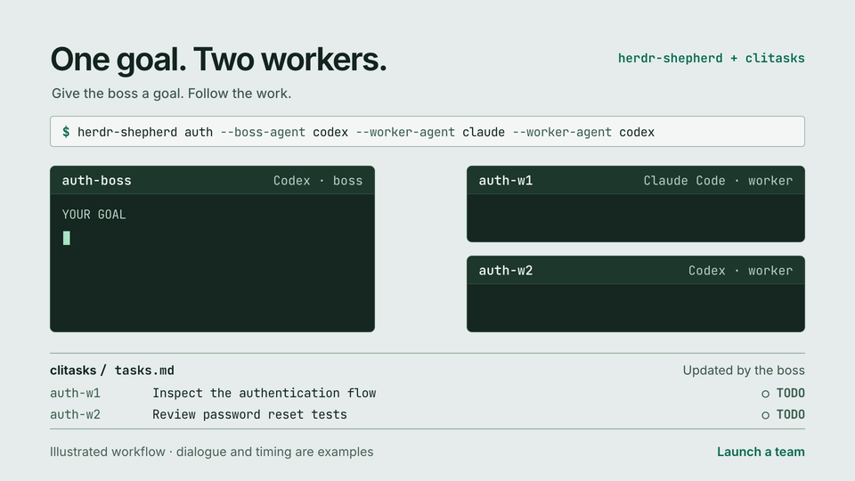
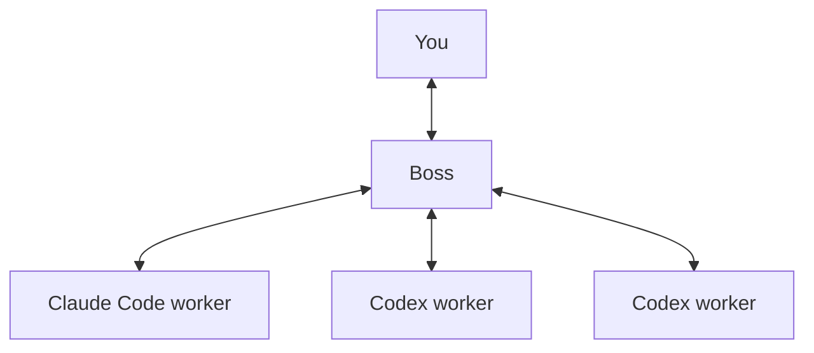
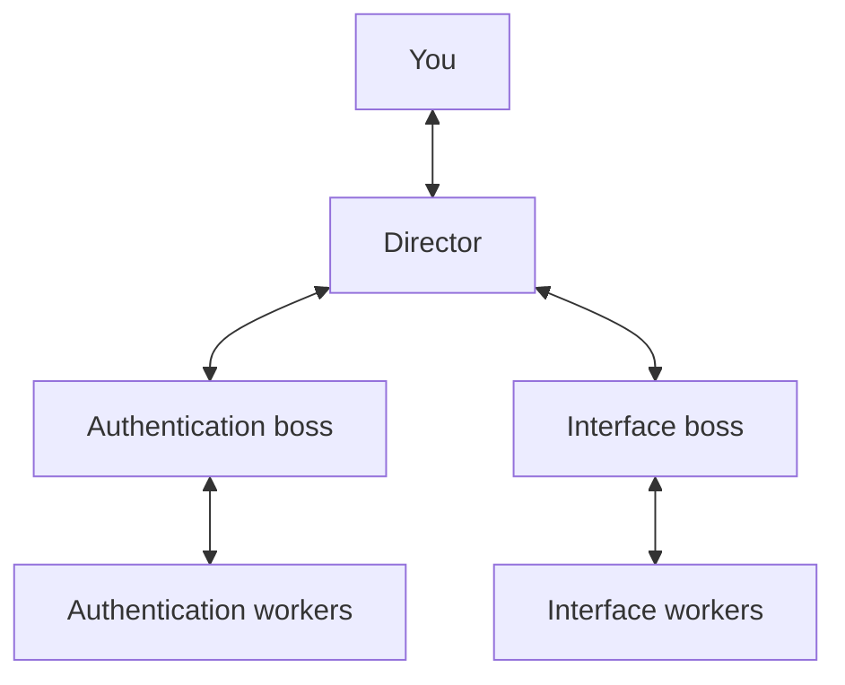

# herdr-shepherd

[](https://github.com/GuitarWag/herdr-shepherd/actions/workflows/ci.yml)
[](https://github.com/GuitarWag/herdr-shepherd/releases/latest)
[](https://github.com/GuitarWag/herdr-shepherd/releases/latest)
[](LICENSE)

Run Claude Code and Codex as a team. Give the boss a goal; it delegates to workers in their own terminal sessions.

Mix agent types and models in the same team. Each agent keeps its own process, context, and permissions. Open the board to see who's working, read their screens, and send a message.



*The password-reset example, illustrated: one boss, two workers, and a shared task board.*

## How the team fits together



The **boss** breaks down your request, assigns work, and checks the results. **Workers** handle the tasks it gives them. The bundled [agent skill](skills/herdr-shepherd/SKILL.md) teaches each session how to find its teammates and communicate.

[herdr](https://herdr.dev) provides the terminal sessions. **herdr-shepherd** starts the team, assigns its roles, and gives you a board to manage it. Add [clitasks](https://github.com/GuitarWag/clitasks) when you want a shared task board alongside those sessions.

## Start working

[Install herdr-shepherd](#install), then start herdr from a normal terminal outside an agent session:

```sh
herdr
```

Inside herdr, go to your project folder and open the board:

```sh
cd /path/to/project
herdr-shepherd
```

1. Press **n** to create a team.
2. Enter a unique team name, choose the folder, and select a boss and workers.
3. Press **Enter** to launch. Open the boss's pane and give it your goal.

For example:

> Add password reset. Have one worker inspect the authentication flow and another review the tests. Propose a plan before editing.

The boss and workers receive their role instructions at startup. The boss waits for your request; workers wait for the boss to assign work.

Prefer a command? Start a Codex boss with one Claude Code worker and one Codex worker:

```sh
herdr-shepherd auth --cwd /path/to/project \
  --boss-agent codex --worker-agent claude --worker-agent codex
```

This creates `auth-boss`, `auth-w1`, and `auth-w2`. Add `--dry-run` to preview a launch. Both roles default to Claude Code; the default worker count is three.

All agents in a team start in the same folder. Give editing workers separate files, or use one editing worker at a time, to avoid overwriting changes.

## Follow the work

Run `herdr-shepherd` in another herdr pane to keep the board open while the team works. It refreshes every two seconds and shows the selected agent's screen and unread messages.

| Key | Action |
| --- | --- |
| Up / Down | Select a team or agent. |
| Left / Right | Fold or unfold a group. |
| Enter | Open the selected agent's tab. |
| **n** | Start a team. |
| **a** | Add a worker to the selected team. |
| **m** | Write a message to the selected agent. |
| **r** | Read its oldest unread message. |
| **d** | Start a director. |
| **q** | Quit the board. |

You can also inspect a team from the CLI:

```sh
herdr-shepherd auth --team
herdr-shepherd auth --team --json
```

For messages from a shell, use shepherd's mailbox:

```sh
herdr-shepherd auth --send boss --message "Review the plan before editing."
```

Check that the recipient is idle and has no unrelated unsent input before sending. The [agent skill](skills/herdr-shepherd/SKILL.md) covers delegation, checking results, and replies.

## Coordinate several teams

Add a **director** when one goal spans several teams. You give the director the overall goal; it coordinates bosses, and each boss manages its own workers.



```sh
herdr-shepherd release --director --cwd /path/to/project
herdr-shepherd auth --under release --cwd /path/to/project --workers 2
herdr-shepherd ui --under release --cwd /path/to/project --workers 2
```

The board groups these teams under `release-director`. You can create this structure from the board too: select the director, then press **n** to create a team under it. Directors communicate with bosses; bosses communicate with workers.

## Pair it with clitasks

Use **herdr-shepherd to coordinate the agents** and **[clitasks](https://github.com/GuitarWag/clitasks) to track the work**. clitasks stores priorities, assignees, dependencies, and progress in a Markdown task board that humans and agents can read.

After [installing clitasks](https://github.com/GuitarWag/clitasks#install), initialize a board in your project and register its skills for the agents you use:

```sh
cd /path/to/project
tasks init --name "Password reset"
tasks claude
tasks codex
tasks add "Inspect the authentication flow" -a auth-w1
tasks add "Review password reset tests" -a auth-w2
```

Then tell the boss:

> Use tasks.md as the task board. Read the existing tasks, coordinate auth-w1 and auth-w2, and update each task as work starts, finishes, or becomes blocked. Keep task board updates with you so workers can focus on their assigned files.

Open `tasks tui` in another pane to follow the board. clitasks also provides a timeline and task dependencies; see its [usage guide](https://github.com/GuitarWag/clitasks#usage).

This is a workflow you give the boss: agent names can be task assignees, and the boss updates the board through `tasks`. Starting a shepherd team does not automatically create or update clitasks tasks.

## Install

You need **herdr 0.7.3+** and an authenticated **Claude Code**, **Codex**, or both on your PATH. clitasks is optional.

Download a compiled release for macOS or Linux; no Rust toolchain is needed:

```sh
case "$(uname -s)/$(uname -m)" in
  Darwin/arm64) target=aarch64-apple-darwin ;;
  Darwin/x86_64) target=x86_64-apple-darwin ;;
  Linux/aarch64|Linux/arm64) target=aarch64-unknown-linux-gnu ;;
  Linux/x86_64) target=x86_64-unknown-linux-gnu ;;
  *) echo "See the releases page for supported platforms."; exit 1 ;;
esac
curl -fsSL "https://github.com/GuitarWag/herdr-shepherd/releases/latest/download/herdr-shepherd-$target.tar.gz" | tar -xz
./herdr-shepherd/install.sh
export PATH="$HOME/.local/bin:$PATH"
herdr-shepherd --version
```

The installer links the commands and registers the shared skill for Claude Code and Codex. Keep the unpacked folder: the links point to it. To upgrade, unpack a newer release over the same folder.

<details>
<summary>Build from a source checkout</summary>

Requires Rust 1.89+ and a C linker. From this repository:

```sh
cargo build --release --locked
./install.sh
export PATH="$HOME/.local/bin:$PATH"
```

</details>

If an existing command blocks installation, see [command-only installation](docs/reference.md#keep-existing-command-aliases).

## Reference

- [Launcher controls](docs/reference.md#launcher), [agent and model options](docs/reference.md#command-options), and [default models](docs/reference.md#default-agents-and-models).
- [Join an existing team](docs/reference.md#join-and-discover-a-team) and [mailbox commands](docs/reference.md#send-messages-between-agents).
- [Installation details](docs/reference.md#installation-details) and [development checks](docs/reference.md#development-and-validation).
- [Agent skill](skills/herdr-shepherd/SKILL.md): the communication protocol agents follow, including the underlying herdr commands.

## License

[MIT](LICENSE).
